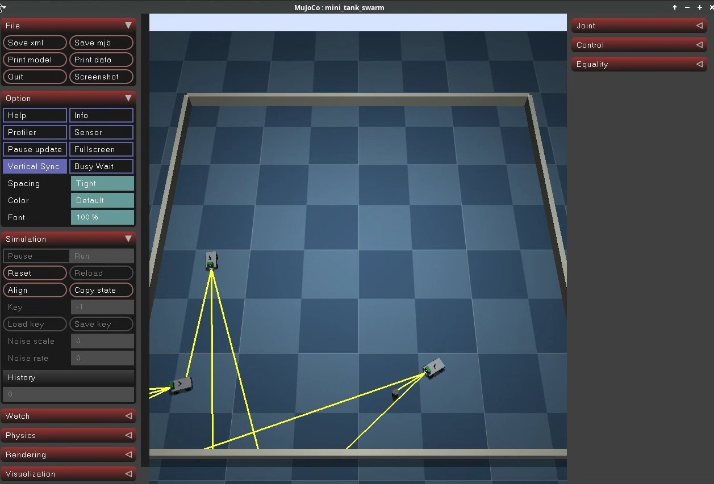
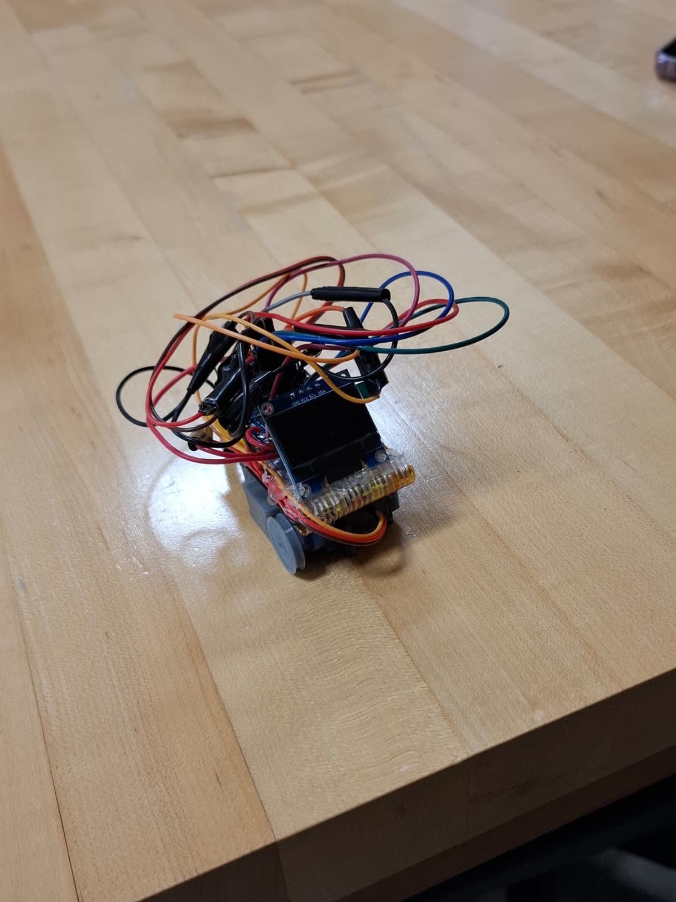
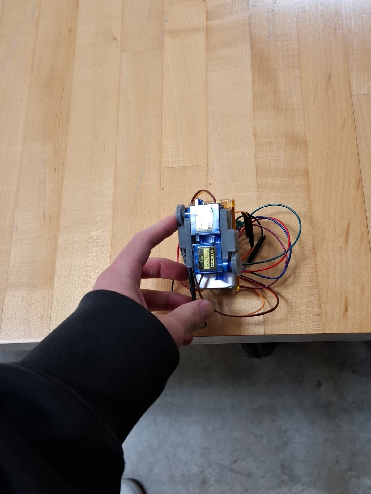

# MiniTank Swarm

**Three small tank robots that work together without ever messaging each other.**

Each robot runs the same simple set of rules and reacts only to what its own sensors see. They talk through light: every tank wears an RGB LED, keeps its distance from the others while sweeping, and turns from **blue** to **green** when it finds the goal. Teammates that see green come over and turn green too. The group organises itself (implicit coordination), with no radio and no leader.

**Status:** 🟡 First prototype built; swarm behaviour working in simulation

  
   <em>Three simulated tanks sweeping an arena in MuJoCo. Yellow lines are what each tank's sensors see.</em>

---

## How it works

Each tank cycles through three states:

1. **Sweep** — drive around the arena, keep a set distance from teammates, avoid walls, and stop now and then to spin and look around
2. **Detect** — the tank that finds the goal drives to it and glows **green**; teammates that see green head over to it
3. **Resume** — turn away, ignore the goal for a while, and go back to sweeping

The rules are tested and tuned in the MuJoCo physics simulator first, with realistic sensor noise and imperfect motors, then ported to the real robots.

## The robots

Each MiniTank is a small, low-cost robot built on an ESP32-S3, adapted from a Cozmo-style desktop robot into a tank.

| | |
|---|---|
| **Brain** | ESP32-S3 |
| **Drive** | 2 micro servos, modified to spin a full 360° |
| **Senses** | Camera, laser distance sensor (VL53L0X), gyroscope (MPU-6050) |
| **Signals** | RGB LED (blue = searching, green = found it) |
| **Display** | OLED screen |
| **Power** | 3.7 V LiPo battery with on/off switch |
| **Swarm size** | 3 robots |

The design builds on the [MKCOZMO-CONTROLLER](https://github.com/nturmose21/MKCOZMO-CONTROLLER) robot.

  
  
   <em>Prototype 1. The next version cleans up the wiring with a proper schematic.</em>

  
   <em>CAD model in Fusion 360, used to build the simulation</em>

## Roadmap

- [x] Robot model running in MuJoCo
- [x] First hardware prototype built
- [x] Swarm behaviour (3 tanks) working in simulation
- [ ] Servos converted to 360° and calibrated
- [ ] Clean schematic and tidy second prototype
- [ ] All sensors and RGB LED on board
- [ ] Behaviour tuned in simulation
- [ ] Rules ported to the ESP32
- [ ] Three real tanks working as a swarm
- [ ] Later: explore reinforcement learning on top

## Progress

**October 2026**
- Project kicked off. Chose the hardware platform (ESP32-S3, tank chassis) and the simulation pipeline (MuJoCo).
- Built the first robot model in Fusion 360, weighed the real parts, and converted the model into a MuJoCo XML file with real masses and inertia.
- Set up the simulation environment (Docker + JupyterLab) and started test-driving the tank model in MuJoCo with left and right motor controls.
- First working simulation: the tank drives forward, back, left and right from the keyboard in MuJoCo.
- Finished Part 1 of the *Reinforcement Learning for Robotics* series: from CAD model to a drivable robot in MuJoCo.
- **New direction:** coordination now comes from a shared set of rules (a state machine) and LED signals instead of reinforcement learning. MuJoCo is used to test and tune those rules.
- Three tanks now sweep, keep their spacing and gather at a found goal in simulation, with realistic sensor noise and imperfect motors.
- Built the first hardware prototype and added the laser distance sensor and RGB LED.
