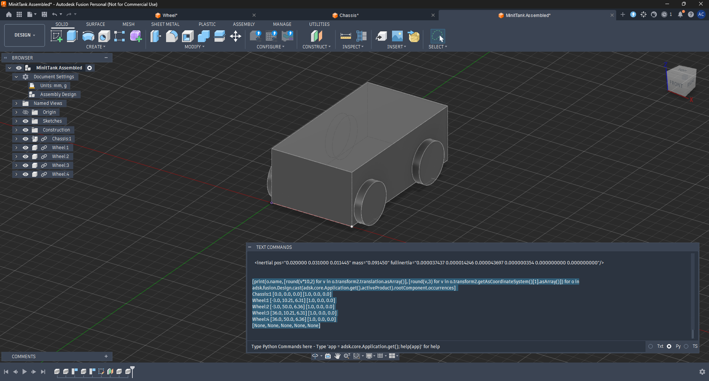

# MiniTank Swarm RL

**Three small tank robots learning to work together, with no robot telling the others what to do.**

Each robot learns its behavior through reinforcement learning in a physics simulator, using only its own sensors. The goal is for coordination between the three to emerge from training (implicit coordination) rather than from messages passed between them.

**Status:** 🟡 Early stage — planning and learning the simulation pipeline

---

## The robots

Each MiniTank is a small, low-cost robot built on an ESP32-S3 microcontroller, adapted from a Cozmo-style desktop robot into a tank-style chassis.

| | |
|---|---|
| **Brain** | ESP32-S3 |
| **Body** | Tank-style chassis |
| **Senses** | Camera, microphone, gyroscope |
| **Swarm size** | 3 robots |

The design builds on the [MKCOZMO-CONTROLLER](https://github.com/nturmose21/MKCOZMO-CONTROLLER) robot.

  
   <em>First CAD model of the MiniTank in Fusion 360</em>

## How it works

1. **Simulate** — build a digital model of the robot in the MuJoCo physics simulator
2. **Train** — let the robots learn behaviors through trial and error with reinforcement learning
3. **Transfer** — load the trained behavior onto the real robots (sim-to-real)

The learning path follows DigiKey and Shawn Hymel's *Reinforcement Learning for Robotics* video series.

## Roadmap

- [ ] Robot model running in MuJoCo
- [ ] Tank chassis designed and built
- [ ] Sensors (camera, microphone, gyroscope) on board
- [ ] One robot trained in simulation
- [ ] Three robots trained together as a swarm
- [ ] Trained swarm running on real hardware

## Progress

**October 2026**
- Project kicked off. Chose the hardware platform (ESP32-S3, tank chassis) and the simulation pipeline (MuJoCo).
- Built the first robot model in Fusion 360, weighed the real parts, and converted the model into a MuJoCo XML file with real masses and inertia.
- Set up the simulation environment (Docker + JupyterLab) and started test-driving the tank model in MuJoCo with left and right motor controls.
